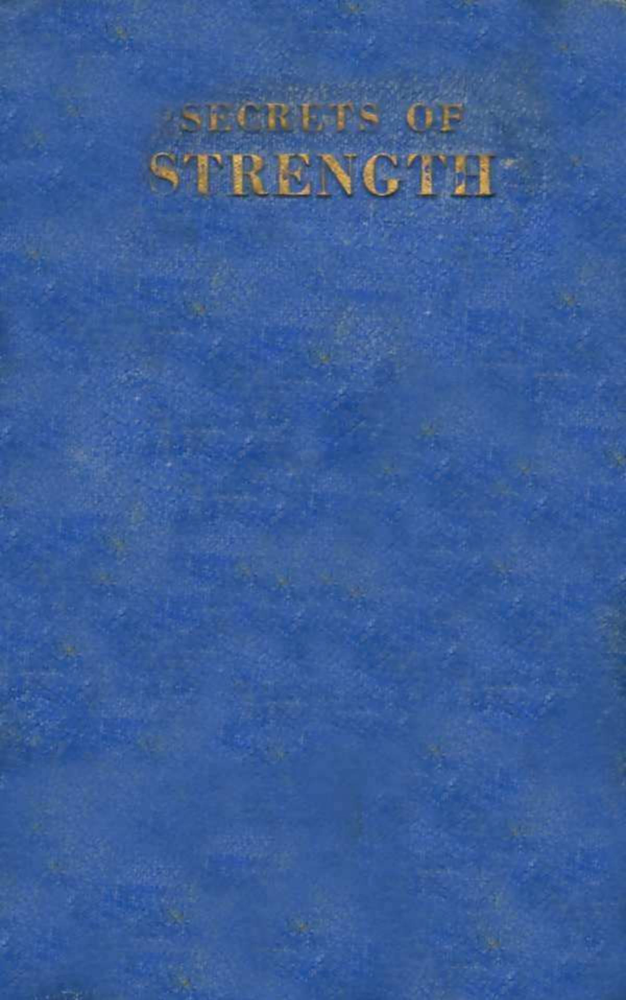

# SECRETS OF STRENGTH

## PREFACE

WHEN you go to the theatre and become absorbed in the play, you seldom give a thought to what is going on behind the scenes. To the public the back stage is somewhat of a mystery. The illusion of the play would undoubtedly be spoiled if the public could look behind the wings.

Like plays, books are presented at their best to the reader, and it is seldom known why and how they came into being. If the reader could see the original manuscript of the book, with all its scribbling, corrections and blots, considerable interest would be lost for the story.

Just as the actor lives his part, so the author must literally breathe with his characters. However, this is not a story book ; nevertheless, I have lived and dreamed every one of the hours all over again that I have spent with the various strong men who are mentioned within these pages.

While it took me but a short time to actually write the original manuscript, it took me years of thought and planning to gather all the facts together, once more, in my memory. They were like pleasant day-dreams. Some plans were formed while I roamed the interior of Alaska, some in Europe, still others under the lazy sun of the Tropics.

Throughout my travels, I met many Strong Men, and when I did, it was like meeting friends, for you know, one Strong Man is always a friend to the other, even though they have never been introduced. They have been through the same hardships and experienced the same progress in moulding their bodies to their maximum

development and power. For every Strong Man I met, I met thousands of weaklings. Poor health was evident everywhere and even where health reigned, strength was lacking.

So many times, if it were possible, I have longed to gather all the weak ones, interest them more thoroughly in their bodies and explain to each and every one, how he could, with but little effort, quickly improve his physique and strength. This was impossible. I therefore resolved to tell the world what I know of the word "Strength." My plans increased and my mind seemed filled to the bursting point with material to tell to those weak individuals, and like a talkative woman who has been suppressed in her speech for a while and then suddenly released, the words burst forth in such rapidity that it took me but a few weeks to write them down. I offer them for your approval in this book and I hope the readers will derive the benefits from these pages that I have aimed to give them.

EARLE E. LIEDERMAN

# CONTENTS

|                                                              | PAGE |
|--------------------------------------------------------------|------|
| PREFACE . . . . .                                            | 5    |
| INTRODUCTION . . . . .                                       | 9    |
| CHAPTER                                                      |      |
| I. INHERITED AND ACQUIRED STRENGTH . . . .                   | 17   |
| II. POWER AND STRENGTH (SIZE AND WEIGHT) . . . .             | 35   |
| III. STRENGTH THROUGH MUSCULAR DEVELOPMENT . . . .           | 50   |
| IV. ARE SMALL BONES A BAR TO STRENGTH? . . . .               | 79   |
| V. STRENGTH THROUGH NATURAL ADVANTAGES . . . .               | 97   |
| VI. "QUALITY OF MUSCLE THE BASIS OF STRENGTH" . . . .        | 107  |
| VII. "STRENGTH THROUGH SYMMETRY" . . . . .                   | 122  |
| VIII. STRENGTH FROM PERFECT DIGESTION . . . . .              | 133  |
| IX. THE IMPORTANCE OF BIG LUNGS AND A STRONG HEART . . . . . | 140  |
| X. THE SECRET OF NERVOUS ENERGY . . . . .                    | 151  |
| XI. BUILDING VITAL FORCE AND RESERVE ENERGY . . . .          | 161  |
| XII. BUILDING STRENGTH . . . . .                             | 188  |

# LIST OF ILLUSTRATIONS

| THE AUTHOR                     | <i>Frontispiece</i> | PAGE |
|--------------------------------|---------------------|------|
| EUGEN SANDOW . . . . .         | . . . . .           | 21   |
| GEORGE HACKENSCHMIDT . . . . . | . . . . .           | 27   |
| GEORGE LURICII . . . . .       | . . . . .           | 33   |
| EDWARD ASTON . . . . .         | . . . . .           | 39   |
| JOSEPH NORDQUEST . . . . .     | . . . . .           | 45   |
| ARTHUR SAXON . . . . .         | . . . . .           | 51   |
| ARTHUR SAXON . . . . .         | . . . . .           | 57   |
| THOMAS INCH . . . . .          | . . . . .           | 63   |
| ANTONE MATYSEK . . . . .       | . . . . .           | 69   |
| JOHN Y. SMITH . . . . .        | . . . . .           | 75   |
| LOUIS CYR . . . . .            | . . . . .           | 81   |
| ADOLPH NORDQUEST . . . . .     | . . . . .           | 87   |
| ADOLPH NORDQUEST . . . . .     | . . . . .           | 93   |
| OTTLEY R. COULTER . . . . .    | . . . . .           | 99   |
| WARREN L. TRAVIS . . . . .     | . . . . .           | 103  |
| GEORGE JOWETT . . . . .        | . . . . .           | 111  |
| WILLIAM GERARDI . . . . .      | . . . . .           | 117  |
| TONY MASSIMO . . . . .         | . . . . .           | 125  |
| EUGEN SANDOW . . . . .         | . . . . .           | 129  |
| EUGEN SANDOW . . . . .         | . . . . .           | 135  |
| JOSEPH NORDQUEST . . . . .     | . . . . .           | 143  |
| JOSEPH NORDQUEST . . . . .     | . . . . .           | 147  |
| TONY MASSIMO . . . . .         | . . . . .           | 153  |
| JOSEPH NORDQUEST . . . . .     | . . . . .           | 157  |
| EUGEN SANDOW . . . . .         | . . . . .           | 163  |
| ADOLPH NORDQUES . . . . .      | . . . . .           | 169  |
| JOSEPH VITOLE . . . . .        | . . . . .           | 175  |
| HENRY STEINBORN . . . . .      | . . . . .           | 181  |
| BOBBY PANDOUR . . . . .        | . . . . .           | 199  |

## INTRODUCTION

To the average young man there is no subject quite so fascinating as a discussion of physical strength. You can prove this to yourself any time you care to start a discussion among your friends. All you have to do is to remark that a certain acquaintance of yours is certainly the strongest fellow in town. Immediately all your friends will want to know just how strong he is, and each man present will insist that *he* knows a fellow who is "terribly strong." Claims and counter-claims will be made, and before you know it, the discussion will have taken a new turn, and those present will be talking about the great "Strong Men" of past and present time. You will be told of feats of strength performed by unknown men which would put Samson and Hercules in the class of the "also rans," and you will hear of men so prodigiously developed that that giant, the late Louis Cyr, would have seemed small by comparison. Eventually and inevitably the talk will veer around to the question of "What makes a man strong?" and then you will hear some of the most fantastic beliefs and theories that the mind of man can conceive.

Among the uninformed, the general consensus of opinion is that either a "Strong Man" is "born strong" or else that he is in possession of some mysterious secret, or secrets, which account for his phenomenal strength.

How do I know all this? Well, because I have "listened in" on many such a confab. Why, once while on tour, I went to get shaved in the hairdressing

saloon of a small hotel. The place being full I had to wait my turn. One of the other customers, while waiting for a hair-cut, was reading a copy of a well-known sporting paper and came across the picture of an amateur "Strong Man" lifting an apparently heavy weight. He showed the picture to the barber and soon all hands were engaged in the usual argument about strength and muscles. The names of great strength-athletes were mentioned, and to my surprise I found that I had a champion. This lad said, "I tell you the strongest of the lot is that feller, Earle E. Liederman." When pressed for his reasons he explained that he thought I had the "grandest arm" of them all.

Now, according to all the rules, that should have been the cue for me to step forward, roll up my sleeve so as to display the arm in question, and say, "Behold ! I am he"—or something like that. Whereas what I actually did was to remain in the background and keep my mouth shut. For I know what these "Strong Man" fans are like. If I had butted into the conversation, they would have kept me there an hour answering their questions. There really is a tremendous curiosity about "Strong Men"—their lives, measurements, feats of strength, and particularly their methods of training.

A real "Strong Man" excites a great deal of interest and curiosity. When he is giving theatrical performances, there will always be a little crowd of young men who hang around the stage door and wait for him to come out, just so as to get a good look at him at close quarters. (Just the way that these girl music-students do to the famous prima donnas.)

And if one chap picks up enough courage to accest the "Strong Man" and engage him in a few seconds' conversation, then that chap has something to brag about. In the future whenever the great athlete's name is mentioned, he will say, "Oh ! I know *him*. Let's see !

The last time I talked to him was when he was here at the ——— Theatre.”

But, really, any great “ Strong Man ” will tell you that when on the road he holds a continued reception. In the towns he visits, local physical-culturists will ask for introductions to him, seek interviews with him, and beg for signed photographs. If an interview is granted, the visitor, after the usual expressions of regard and admiration, will say, “ *Tell me, Mr. So-and-So, what did you do to get so strong?* ”

Just as if the athlete, who has probably spent years in perfecting his body, could, in a few sentences, tell a beginner how to become equally strong and well-built!

But there it is. Notwithstanding the fact that the average young fellow will, in conversation, loudly proclaim his belief that all “ Strong Men ” are “ born that way,” and at the same time express the opinion that he—the speaker—could never become very strong, nevertheless, he has a secret conviction that if he only “ knew the inside ”—could find out the trade secrets—that he could be just as strong as the strongest of them all.

It would be impossible for me to tell you how many scores of thousands of health-seekers I have trained, but I would be willing to bet that at least fifty thousand individuals have written me letters telling me to lay out their courses so as to make them as strong as possible. It is just natural for a youth to wish to be powerfully developed and tremendously strong as it is for a girl to desire great beauty of face and form. But just the same it is impossible for me to describe the training of a “ Strong Man ” in one short letter, or in one brief interview, as it would be for a champion boxer to tell all the details of his art in a half hour’s talk.

That was my main reason for writing this book. It gives me the opportunity to supplement the instructions I give in my courses. For when a man first starts his

training, it is necessary to confine his work to definite exercises, which are designed to develop the individual muscles, to shape and strengthen the whole body, and to promote a feeling of health and well-being. The first few months of an exercise programme are devoted to what you might call foundation work. Monotonous and tiresome (sometimes), but necessary if a structure of great strength is to be reared.

The acquisition of really great strength, that is, to become as strong yourself as two or three ordinary men, is a problem which requires special training, patience and knowledge, particularly knowledge. Remember, the first thing asked of an expert is, "What shall I do to become strong ?"

In another book of mine I gave a description of the various exercises used by "Strong Men" to develop their tremendous muscles. But everyone who has given the matter any thought, realises that there is more to strength-building than just exercise alone. If your body is to grow steadily—to develop from the undeveloped state of the average man, to the beautifully shaped and terrifically powerful physique of the real strength-athlete, you must learn to regulate your training so as to get that proper balance between exercise, recuperation (sleep) and nourishment which makes for the greatest possible progress.

I have associated so much with "Strong Men" that I have had every opportunity to observe and study both their physical characteristics and their training methods. Much of what I have learned is told in the pages of this book. At that, I feel that I have not told even half of it, although if you will look at the chapter headings you will find that I have dealt with almost every factor relating to strength.

The fact of the matter is that these men most famous for their strength are not only immensely powerful, but

are also what you might call “ virtuosos ” in the strength line. Most of them are experts (a) in the creation of muscle, (b) in the kind of training that at once creates and conserves energy, and (c) in the scientific application of power.

The amateur physical-culturist can, therefore, learn a great deal from the experience of the professional. I feel that I am qualified to speak with some authority on the methods of professionals because, in the first place, I was for several years before the public, doing a “ strong-act ” on the stage; in the second place, because, ever since my early manhood I have been intimately associated with many of the most famous “ Strong Men ” of modern times; and lastly, because I have been successful in the work of aiding thousands of men and boys to achieve the glory that goes with great physical strength.

It is quite natural that magazines devoted to physical training should be illustrated with pictures of finely developed men. But I can remember when, not so very many years ago, even the biggest magazines were lucky if in a single issue they could show pictures of even as many as half a dozen really well-built individuals. Nowadays the supply of such pictures is almost unlimited. Why, I myself issue periodically reports from my pupils, and each little folder shows the pictures of dozens of amateur pupils of mine; many of whom compare favourably in development and strength with the best professionals. In fact, I have on hand enough unpublished pictures of fine physical specimens—contributed by my own pupils—to illustrate all the numbers of a magazine for years to come. Which, if it means anything, is some proof that I have had some success in handling strength cases, even if the bulk of my business is with individuals who are primarily health-seekers.